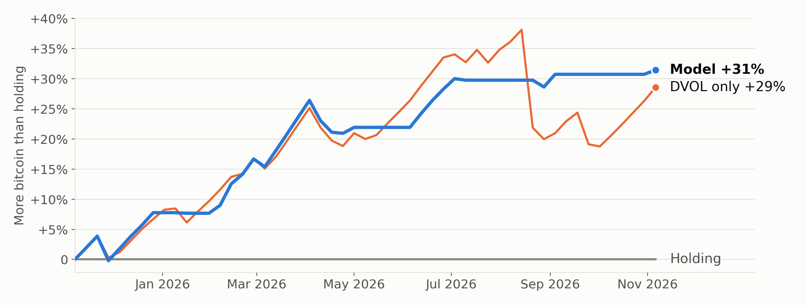
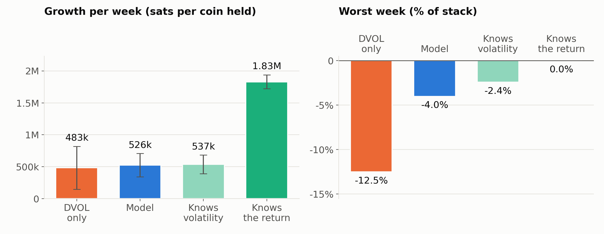

## Action

::: {.headline}
Sell weekly calls on nearly all your coin
:::

:::: {.columns}
::: {.column width="68%"}

:::
::: {.column width="32%"}
::: {.stat}
93%
:::
::: {.statcap}
of the stack written, on average
:::
::: {.sub}
Strike set by DVOL: close to the money above about 40%.
:::
:::
::::

::: {.notes}
I hold bitcoin and can sell a call against it every Friday. Two choices matter: the strike, and how much of the stack to write. The gray line on the title slide is bitcoin since 2021, and the blue part is the year the model never saw. Bitcoin fell through it.

Each dot is one test Friday. When DVOL, the market's expected volatility, is above about 40 percent, the rule sells close to the money. Below that the premium is thin, and it sells 23 to 29 percent above spot, where there is almost nothing at stake. On average it writes 93 percent of the stack, and the size barely matters, because the strike does the work. Strike and size both come from the model's predictive distribution, so the rule is explicit, not a guess.
:::

## Reason

::: {.headline}
+31% more bitcoin than holding
:::

::: {.sub}
Selling weekly calls, over 52 test weeks.
:::

{.nostretch width=88%}

::: {.chip}
Black-Scholes prices, not fills. A falling year.
:::

::: {.notes}
This is selling weekly calls against just holding the coins, measured in bitcoin. Over the 52 weeks the model never saw, the rule ended 31 percent ahead. That is about 526 thousand satoshis per coin per week, standard error 183 thousand, and it was ahead of holding in 85 percent of weeks. Plain DVOL selling did nearly as well, 29 percent. Two caveats. The prices are Black-Scholes at DVOL, not real fills. And bitcoin fell, so most calls expired worthless. The strike matters: a fixed call 10 percent out of the money earned nothing.
:::

## Risk

::: {.headline}
Behind holding in 8 of 52 weeks
:::

{.nostretch width=88%}

::: {.chip}
The test year fell, so a rally is untested.
:::

::: {.notes}
Each bar is one test week. Red is a week the call left me behind holding: 8 of 52, 15 percent. The worst was minus 4.0 percent of the stack, and the average losing week minus 1.3. The orange and purple lines are the worst weeks of the alternatives. The DVOL-only rule lost 12.5 percent in one week, and a full at-the-money call lost 17 percent. That call actually grew slightly more, but its swings are four times as large. What I have not tested is a strong rally, where selling the call caps my gain.
:::

## Value

::: {.headline}
Safety, not growth
:::

::: {.sub}
A tie on growth. The worst week is a third as deep.
:::

{.nostretch width=88%}

::: {.chip}
"Knows" means perfect foresight, not a real forecast.
:::

::: {.notes}
Two questions. The last slide compared selling with holding, and selling won. This one asks whether my model adds anything to simply selling at DVOL's level. On growth it does not: about 43 thousand satoshis more per coin per week, standard error 294 thousand, a tie. A satoshi is one hundred millionth of a bitcoin. My hypothesis, that realized volatility helps, was not supported. What the model buys is safety: the worst week is minus 4 percent, not minus 12.5. The green bars are not forecasts. Knowing next week's volatility exactly would add about 11 thousand satoshis, which is nothing, while knowing the direction would add about 1.3 million. So the value is in direction, and a volatility model cannot give it.
:::
