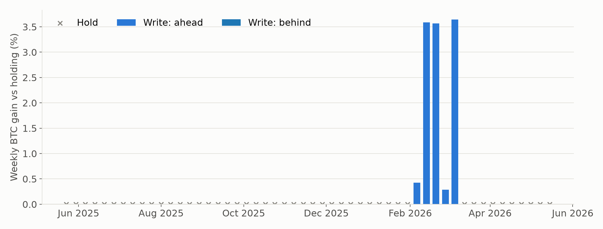

## Action

::: {.headline}
Use forecast payouts to choose the strike
:::

:::: {.columns}
::: {.column width="68%"}
{fig-alt="Each evaluation Friday plotted by trailing spot volatility and strike. Crosses indicate holding."}
:::
::: {.column width="32%"}
::: {.stat}
 / 
:::
::: {.statcap}
Fridays with a call in the main scenario
:::
:::
::::

::: {.notes}
I ask when a bitcoin holder would write a hypothetical weekly covered call, at what strike, and on how much BTC. I estimate a full return distribution from trailing spot volatility, then find the strike with the most expected net BTC and size the position using Kelly. Holding is available every week. The option price is a formula anchored to recent spot volatility with an illustrative cost.
:::

## Reason

::: {.headline}
Does the 7-day signal help?
:::

::: {.sub}
Model  · 30-day baseline  · holding 0%
:::

{.nostretch width=88% fig-alt="Cumulative simulated BTC gains against holding for the full model and the 30-day baseline."}

::: {.notes}
Both models are fitted on the same 240 weeks. I evaluate on the next 52 weeks and give both the same hypothetical premiums. Adding seven days of realized volatility changed weekly log growth by , with a paired interval of  to . The q90 pinball loss was slightly worse after adding seven-day volatility. In a separate comparison, lagged blockchain fees improved q90 pinball loss.
:::

## Risk

::: {.headline}
A rally can cost more than the premium
:::

::: {.sub}
 losses across  simulated writes · worst week  vs holding
:::

{.nostretch width=88% fig-alt="Weekly simulated BTC outcomes. Crosses indicate holding."}

::: {.chip}
Illustration · +20% BTC rally with a forced full ATM call ·  BTC vs holding
:::

::: {.notes}
My least trusted assumption is the premium. The options market's bids are missing. A 20 percent lower premium gives  BTC versus holding in the model's repriced scenario, and a 20 percent higher premium gives . A separate stress test shows what a 20 percent rally can cost on a forced full ATM call.
:::

## Value

::: {.headline}
Blockchain fees helped forecast the upper tail
:::

::: {.sub}
Secondary model ·  sats per BTC held per week
:::

{.nostretch width=88% fig-alt="Paired 95% interval for the change in weekly simulated gain from adding lagged blockchain fees."}

::: {.notes}
Adding lagged fees improved the tail forecast and showed a gain in the simulation. The paired interval,  to  sats per BTC per week, still includes zero. Doubling the training sample changed the evaluated policy's growth by  sats at the displayed precision. Historical bids would test a different uncertainty. For a representative Friday, the forecast payout plus cost required  sats of gross premium per BTC covered at the candidate strike before taking positive exposure.
:::
