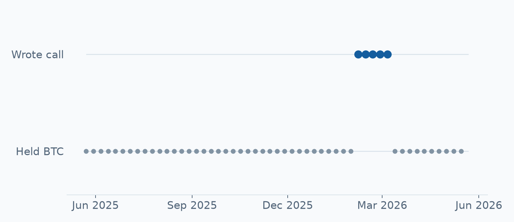

## Action

::: {.headline}
Write only when the premium justifies the payout risk
:::

::: {.sub}
Choose the strike by expected BTC gain, then size with Kelly.
:::

:::: {.deck-grid}
::: {}
{.nostretch fig-alt="Timeline of 52 evaluation weeks, with five call writes in the main simulation."}
:::

::: {.card}
[ of ]{.big}

[weeks with a simulated call]{.small}

[Held BTC in the other  weeks.]{.caption}
:::
::::

::: {.notes}
I ask when a bitcoin holder would write a hypothetical weekly covered call, at what strike, and on how much BTC. I forecast a full weekly return distribution, choose the strike with the most expected net BTC, and size the position by expected log wealth. Holding is available every Friday. Premiums come from a pricing formula anchored to trailing 30-day spot volatility, with an illustrative cost.
:::

## Reason

::: {.headline}
Adding 7-day volatility made little difference
:::

::: {.sub}
240 weeks for training · 52 weeks for testing · same premiums for both models
:::

:::: {.deck-grid}
::: {}
{.nostretch fig-alt="The baseline and the model with seven-day volatility both gained about twelve percent in BTC versus holding, which is zero."}
:::

::: {.card}
[90th-percentile forecast]{.small}

[Error rose from  to .]{.caption}

[Lower quantile loss is better.]{.caption}
:::
::::

::: {.notes}
The exact cumulative gains differ slightly, but both round to 12.0% versus holding under the main hypothetical premium scenario. Adding seven-day volatility changed average weekly log growth by . The 90th-percentile pinball loss measures both the size and direction of forecast errors, with more weight on underestimating this upper quantile.
:::

## Risk

::: {.headline}
The result depends on what buyers pay
:::

::: {.sub}
Simulated BTC gain across three assumed premium levels
:::

:::: {.deck-grid}
::: {}
{.nostretch fig-alt="The model gained 2.0%, 12.0%, and 17.4% versus holding at lower, main, and higher hypothetical premiums."}
:::

::: {.card .risk}
[]{.big}

[BTC versus holding in a rally stress test]{.small}

[Assumes BTC jumps 20% and a full at-the-money call was already written.]{.caption}
:::
::::

::: {.notes}
My least trusted assumption is the premium. The live option bid is unobserved. With premiums reduced by 20%, the model's repriced outcome falls from  to  versus holding. With premiums 20% higher, it rises to . The forced full call is a separate stress scenario. None of the five writes in the main scenario lost BTC versus holding.
:::

## Value

::: {.headline}
Fees improved the forecast, with uncertain gains
:::

::: {.sub}
Adding lagged fees reduced 90th-percentile forecast error from  to .
:::

:::: {.deck-grid}
::: {}
{.nostretch fig-alt="Estimated simulated improvement of 193,095 sats per BTC per week, with a paired 95% interval from −4,894 to +441,937. The interval crosses zero."}
:::

::: {.card}
[The interval crosses zero]{.small}

[Paired 95% interval for simulated gains from adding the fee feature.]{.caption}
:::
::::

::: {.source}
Data: [Coin Metrics Community BTC archive](https://github.com/coinmetrics/data/blob/f1a36afb962731c387bb03982758ab0103063da5/csv/btc.csv) · [CC BY-NC 4.0](https://creativecommons.org/licenses/by-nc/4.0/) · transformed for this study
:::

::: {.notes}
Adding lagged blockchain fees was a secondary test. The 90th-percentile forecast improved on this holdout. The separate portfolio estimate was  sats per BTC held per week, with a paired 95% interval of  to . The point estimate is not required to be the midpoint of a bootstrap percentile interval. True historical bids could test the pricing assumption.
:::
